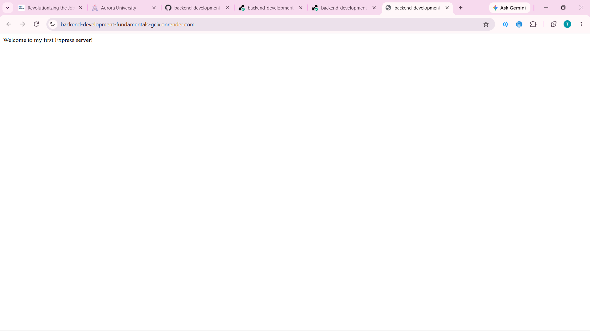
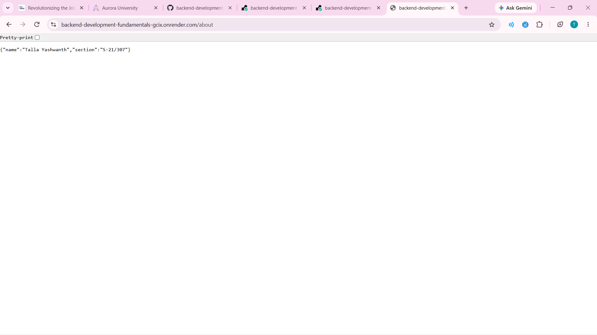
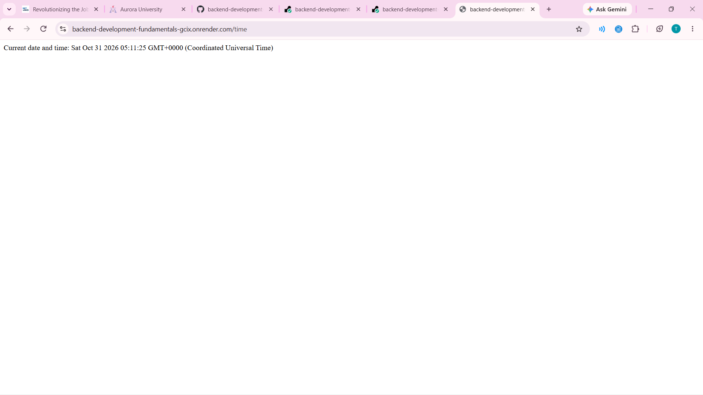
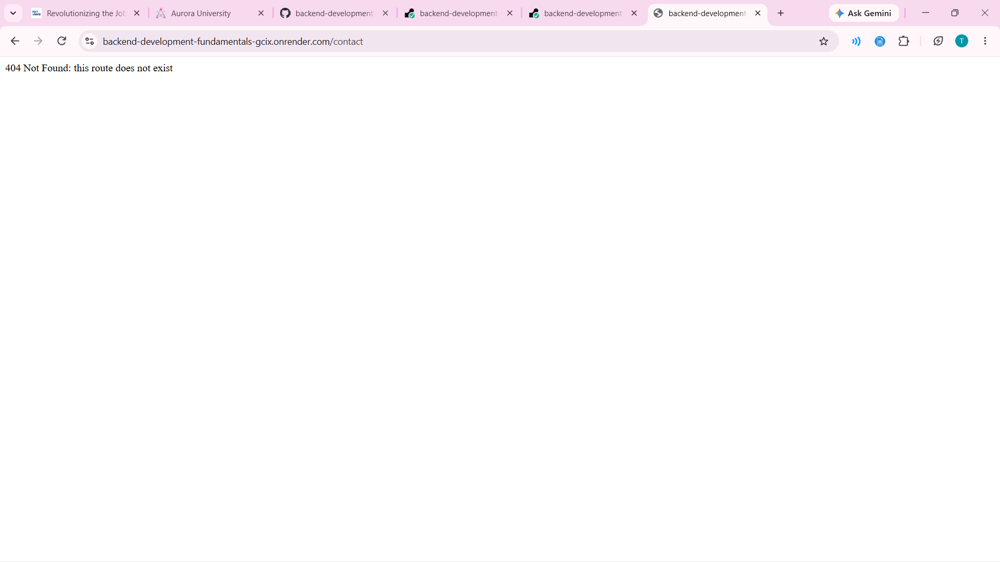

# Lab 1: Node.js and Express server

Talla Yashwanth | 252U1R3092 | Section S-21/307

Live link: https://backend-development-fundamentals-gcix.onrender.com

## How to run
1. Install packages: `npm install`
2. Start the Express server: `npm start`
3. Open http://localhost:3000 in the browser
4. Plain http version (optional): `node plain-server.js`

No environment variables are needed for this lab.

## Endpoints
| Method | Path | Description |
| --- | --- | --- |
| GET | / | Welcome text |
| GET | /about | JSON with name and section |
| GET | /time | Current date and time |
| Any | any other path | 404 message |

## Screenshots (live deployment)

## Notes
- The project is inside the lab-01 folder, so I set the Root Directory to lab-01 on Render.
- Render showed yarn as the default build command, so I changed it to npm install and the start command to npm start.
- The server reads the port from process.env.PORT, because Render assigns its own port.
- The free Render service sleeps when idle, so the first page can take up to 50 seconds to load.
