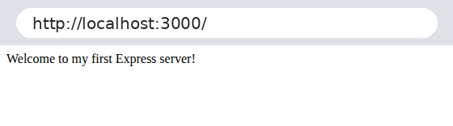
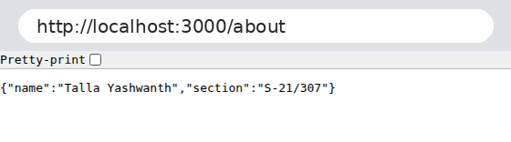
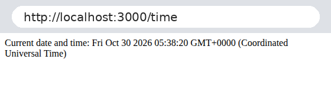
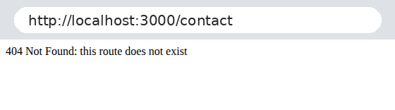
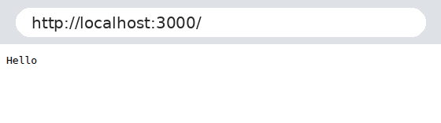

# Lab 1: Node.js and Express server

Talla Yashwanth | 252U1R3092 | Section S-21/307

Live link: Not deployed yet (add the public URL here after deploying)

## How to run
1. Install packages: `npm install`
2. Start the Express server: `node server.js`
3. Open http://localhost:3000 in the browser
4. Plain http version (optional): `node plain-server.js`

No environment variables are needed for this lab.

## Endpoints
| Method | Path | Description |
| --- | --- | --- |
| GET | / | Welcome text |
| GET | /about | JSON with name and section |
| GET | /time | Current date and time |
| Any | any other path | 404 message |

## Screenshots

## Notes
Add your own notes here about problems you faced and how you solved them.
