 
# Lab 3: REST API, query parameters, validation, debugging

**Name:** Talla Yashwanth | **Registration number:** 252U1R3092 | **Section:** S-21/307

**Subject:** Backend Development Fundamentals (Year II, Term II)

**Live link:** https://bdf-lab-03-yashwanth.onrender.com 

---

## About this lab

This lab turns the Lab 2 books routes into a clean REST API. The `/books` resource now supports search, sorting, pagination and a price range filter. Every request body and query parameter is validated, every failure returns the right status code with a JSON message, and the project includes a debugging guide for the four errors from the faculty exercise.

| Area | What was built |
| --- | --- |
| Resource design | Noun based endpoints (`/books`), HTTP method shows the action |
| Query parameters | `search_q`, `order_by`, `order`, `limit`, `offset`, `min_price`, `max_price`, each with a default |
| Validation | POST and PUT body checks, id check, query parameter checks |
| Status codes | 200, 201, 400, 404, 500 used for the right situations |
| Response format | Every response has a `message`, errors are `{ "message": "..." }` |
| Database | SQLite with parameterised queries only |
| Testing | 27 Postman requests (34 assertions) and 30 automated tests with `npm test` |

---

## Concepts used in this lab

### 1. What is a REST API?

REST (Representational State Transfer) is a set of rules for designing web APIs. Instead of calling a different function name for every action, the client works with **resources** (things like books) that have a URL, and uses standard **HTTP methods** to act on them.

| REST principle | Meaning | How this project follows it |
| --- | --- | --- |
| Client and server are separate | The client only knows the URLs, not how the server stores data | Postman or a browser talks to the API, the SQLite file is hidden behind it |
| Stateless | Each request has everything the server needs | No sessions or cookies, every call carries its own query or body |
| Resource based URLs | URLs name things, not actions | `/books/5`, not `/getBookById` |
| Uniform interface | Same methods and status codes everywhere | GET, POST, PUT, DELETE and the same JSON shape on every route |
| Representations | The server sends a representation of the resource, usually JSON | All responses are JSON |

*Real world analogy:* a library catalogue. The shelves (resources) have fixed labels, and the librarian always handles the same small set of requests: look up, add, replace, remove.

### 2. Naming endpoints: nouns, not verbs

The URL says **what**, the HTTP method says **what to do**.

| Bad (verb in URL) | Good (noun + method) |
| --- | --- |
| `GET /getAllBooks` | `GET /books` |
| `POST /createBook` | `POST /books` |
| `POST /updateBook/5` | `PUT /books/5` |
| `GET /deleteBook/5` | `DELETE /books/5` |

Collections use the plural noun (`/books`) and one item is addressed by its id (`/books/5`).

### 3. HTTP methods

| Method | Action | Safe (no change) | Idempotent (same result if repeated) | Success status here |
| --- | --- | --- | --- | --- |
| GET | Read | Yes | Yes | 200 |
| POST | Create | No | No (each call makes a new row) | 201 |
| PUT | Replace / update | No | Yes | 200 |
| DELETE | Remove | No | Yes (the end state is the same) | 200 |

### 4. Query parameter vs path parameter

| | Path parameter | Query parameter |
| --- | --- | --- |
| Example | `/books/5` | `/books?search_q=sql&limit=5` |
| Purpose | Identifies **one specific resource** | **Filters, sorts or pages** a collection |
| Required? | Yes, the URL is incomplete without it | No, optional with defaults |
| Position | Part of the path | After the `?`, joined with `&` |
| Read in Express | `req.params.id` | `req.query.limit` |

Rule of thumb: if you remove it and the request points to a different thing, it is a path parameter. If you remove it and you still get the same collection (just less filtered), it is a query parameter.

### 5. What does stateless mean?

The server does **not remember anything** about previous requests from a client. Every request must contain all the information needed to handle it. For example, `GET /books?limit=5&offset=5` carries its own page number, so the server does not need to remember "this user was on page 1". Benefits: any server instance can answer any request, it is easy to scale, and it is easy to test because a request always behaves the same way.

*Analogy:* a shop counter with no memory. You must say your full order every time, but any cashier can serve you.

### 6. Status codes and when to use them

| Code | Name | Used in this project when |
| --- | --- | --- |
| 200 | OK | Reading, updating or deleting worked |
| 201 | Created | A new book was created with POST |
| 400 | Bad Request | The **input is wrong**: missing title or author, price not a number, bad id, bad query value, broken JSON |
| 404 | Not Found | The input is fine, but **the record or route does not exist** (id 9999, unknown path) |
| 500 | Internal Server Error | A bug or database failure on the server, details are only in the server log |

**400 vs 404 in one line:** 400 means "your request is wrong", 404 means "your request is fine, but there is nothing there". For example `GET /books/abc` is 400 (abc is not an id) and `GET /books/9999` is 404 (a valid id that does not exist).

### 7. Validation

Never trust data from the client. The browser form can be skipped completely, since anyone can call the API with Postman or curl. All checks are done on the server in `utils/validate.js`.

| Input | Rule | Failure result |
| --- | --- | --- |
| `title`, `author` | Required, non-empty text (spaces are trimmed) | 400 |
| `price` | Required, a number, 0 or more | 400 |
| `:id` | Positive whole number | 400 |
| `limit` | Whole number from 1 to 100, default 10 | 400 |
| `offset` | Whole number, 0 or more, default 0 | 400 |
| `order_by` | One of `id`, `title`, `author`, `price`, default `id` | 400 |
| `order` | `ASC` or `DESC`, default `ASC` | 400 |
| `min_price`, `max_price` | Numbers, and `min_price` cannot be above `max_price` | 400 |
| Request body | Must be valid JSON | 400 |

If several fields are wrong in one request, all the problems are returned together in one message, so the client can fix them in one go.

### 8. Consistent response format

Clients are easier to write when every response looks the same.

```json
{ "message": "Books fetched", "total": 12, "count": 2, "limit": 2, "offset": 0, "data": [ ... ] }
```

```json
{ "message": "price must be a number" }
```

Every success has a `message` and usually `data`. Every error is only `{ "message": "..." }`. The same format is used for validation errors, 404s, unknown routes, bad JSON and 500 errors.

### 9. SQL used for search, filter, sort and pages

| Feature | SQL idea | Notes |
| --- | --- | --- |
| Search | `title LIKE ?` with `%text%` | `%` matches any characters. SQLite LIKE is case-insensitive for English letters |
| Price range | `price >= ?` and `price <= ?` | Same as `BETWEEN min AND max` (BETWEEN includes both ends). Two conditions are used so either bound can be left out |
| Sorting | `ORDER BY column ASC/DESC` | Column name is checked against a whitelist |
| Pagination | `LIMIT ? OFFSET ?` | `offset = (page - 1) * limit`. Page 3 with limit 5 is `offset=10` |
| Total count | `SELECT COUNT(*) ... WHERE ...` | Uses the same filters, so `total` is the number of matches, not the page size |

### 10. Parameterised queries and SQL injection

Building SQL by joining user input into the string is dangerous:

```js
// WRONG: user controls the SQL
db.all("SELECT * FROM books WHERE title LIKE '%" + search_q + "%'");
// search_q = "' OR '1'='1"  changes the meaning of the query
```

The project always uses placeholders, so the database treats the value as **data**, never as SQL:

```js
db.all("SELECT * FROM books WHERE title LIKE ?", [`%${search_q}%`]);
```

Two extra details in this project:

- **ORDER BY cannot use a `?` placeholder** (placeholders are for values, not column names). So `order_by` and `order` are checked against a fixed whitelist before they are put in the SQL text. Anything else gives 400, which stops input like `price;DROP TABLE books`.
- **LIKE wildcards typed by the user** (`%` and `_`) are escaped with `ESCAPE '\'`, so searching for `%` finds a literal percent sign instead of matching every row.

### 11. async / await and error handling

Database calls return Promises, so the route handlers are `async` and every call uses `await`. Express 5 sends a rejected promise to the error handler automatically, so a database failure becomes a clean `500` with `{ "message": "Internal server error" }` while the full error is printed only in the server log (the client never sees internal details). A missing `await` does not crash. It silently sends an empty result, which is covered in the debugging guide.

---

## Endpoints

| Method | Path | Description | Success | Failure |
| --- | --- | --- | --- | --- |
| GET | `/` | API name and endpoint list | 200 | |
| GET | `/books` | List books with search, sort, price range and pagination | 200 | 400 |
| GET | `/books/:id` | Get one book | 200 | 400, 404 |
| POST | `/books` | Create a book | 201 | 400 |
| PUT | `/books/:id` | Update a book (title, author and price all required) | 200 | 400, 404 |
| DELETE | `/books/:id` | Delete a book | 200 | 400, 404 |

### Query parameters for `GET /books`

| Parameter | Default | Description | Example |
| --- | --- | --- | --- |
| `search_q` | none | Partial title match using LIKE | `search_q=sql` |
| `order_by` | `id` | `id`, `title`, `author` or `price` | `order_by=price` |
| `order` | `ASC` | `ASC` or `DESC` | `order=DESC` |
| `limit` | `10` | Rows per page, 1 to 100 | `limit=5` |
| `offset` | `0` | Rows to skip | `offset=10` |
| `min_price` | none | Lowest price | `min_price=300` |
| `max_price` | none | Highest price | `max_price=450` |

All of them can be combined: `GET /books?search_q=java&max_price=400&order_by=title&limit=5`

### Request body for POST and PUT

```json
{ "title": "Express in Action", "author": "Evan Hahn", "price": 475 }
```

### Example responses

`POST /books` returns **201**:

```json
{ "message": "Book created", "data": { "id": 13, "title": "Express in Action", "author": "Evan Hahn", "price": 475 } }
```

`POST /books` with `"price": "abc"` returns **400**:

```json
{ "message": "price must be a number" }
```

`GET /books/9999` returns **404**:

```json
{ "message": "Book with id 9999 not found" }
```

---

## How to run

**Requirements:** Node.js 20 or newer and npm.

```bash
# 1. go into the lab folder
cd lab-03

# 2. install the packages (express, sqlite, sqlite3)
npm install

# 3. create your environment file (it is never committed)
cp .env.example .env        # on Windows: copy .env.example .env

# 4. start the server
npm start                   # or: npm run dev  (reads the .env file)
```

Open http://localhost:3000/books in the browser.

### Environment variables

| Variable | Required | Description | Default |
| --- | --- | --- | --- |
| `PORT` | No | Port the server listens on (Render sets it automatically) | `3000` |
| `DB_PATH` | No | Path of the SQLite database file | `./books.db` |

`.env.example` contains the names with safe example values. The real `.env` file is in `.gitignore` and must never be committed. The database file is created and filled with 12 sample books on the first start.

### Run the automated tests

```bash
npm test
```

This starts the app on a random port with a temporary database, runs 30 tests covering success and failure cases, and deletes the temporary database afterwards.

### Run the Postman tests

1. Open Postman and choose **Import**, then select `postman/BDF-Lab-03.postman_collection.json`.
2. Start the server (`npm start`).
3. The collection variable `baseUrl` is `http://localhost:3000`. Change it to the live link to test the deployed API.
4. Run the whole collection with the **Run** button. It has 27 requests and 34 assertions.

---

## Project structure

```
lab-03/
  server.js                 app setup, routes, 404 and error handler
  db.js                     opens SQLite, creates the books table, seeds sample data
  routes/books.js           all /books endpoints
  utils/validate.js         validation for ids, bodies and query parameters
  tests/api.test.js         automated tests (npm test)
  postman/                  importable Postman collection
  screenshots/              proof of working output
  .env.example              environment variable names, no real values
  .gitignore                node_modules, .env and database files
  package.json
  README.md
```

---

## Postman test list

Each row is one request in the Postman collection and one check in the automated tests. The list covers both success and failure cases.

| ID | Type | Method | Request | Status | What to check |
| --- | --- | --- | --- | --- | --- |
| T01 | Success | GET | `/books` | 200 | Rows ordered by id, limit 10, offset 0 |
| T02 | Success | GET | `/books?search_q=sql` | 200 | Only titles containing sql |
| T03 | Success | GET | `/books?order_by=price&order=DESC&limit=5` | 200 | Highest price first |
| T04 | Success | GET | `/books?limit=3&offset=3` | 200 | 3 rows, starting from the 4th |
| T05 | Success | GET | `/books?min_price=300&max_price=450&order_by=price` | 200 | Prices from 300 to 450 |
| T06 | Success | GET | `/books?search_q=java&max_price=400&order_by=title` | 200 | Title has java, price 400 or less, sorted by title |
| T07 | Success | GET | `/books/1` | 200 | The book with id 1 |
| T08 | Success | POST | `/books` | 201 | New book with its id, message Book created |
| T09 | Success | PUT | `/books/{{newId}}` | 200 | Updated book, message Book updated |
| T10 | Success | DELETE | `/books/{{newId}}` | 200 | message says the book was deleted |
| T11 | Failure | GET | `/books/{{newId}}` | 404 | message says the book was not found |
| T12 | Failure | PUT | `/books/9999` | 404 | message says the book was not found |
| T13 | Failure | DELETE | `/books/9999` | 404 | message says the book was not found |
| T14 | Failure | POST | `/books` | 400 | message mentions title |
| T15 | Failure | POST | `/books` | 400 | message mentions author |
| T16 | Failure | POST | `/books` | 400 | message: price must be a number |
| T17 | Failure | POST | `/books` | 400 | message: price cannot be negative |
| T18 | Failure | POST | `/books` | 400 | message lists title, author and price |
| T19 | Failure | POST | `/books` | 400 | message: Request body is not valid JSON |
| T20 | Failure | GET | `/books/abc` | 400 | message: id must be a positive whole number |
| T21 | Failure | GET | `/books?order_by=publisher` | 400 | message lists the allowed columns |
| T22 | Failure | GET | `/books?order=sideways` | 400 | message: order must be ASC or DESC |
| T23 | Failure | GET | `/books?limit=1000` | 400 | message: limit must be a whole number between 1 and 100 |
| T24 | Failure | GET | `/books?offset=-1` | 400 | message: offset must be a whole number, 0 or more |
| T25 | Failure | GET | `/books?min_price=cheap` | 400 | message: min_price must be a number |
| T26 | Failure | GET | `/books?min_price=500&max_price=100` | 400 | message: min_price cannot be greater than max_price |
| T27 | Failure | GET | `/authors` | 404 | message: Route GET /authors not found |

---

## Debugging guide

The faculty exercise has four common errors. Each one is shown below with the real error output, the cause and the fix.

| # | Error | Cause | Fix |
| --- | --- | --- | --- |
| 1 | `listen EADDRINUSE: address already in use` | Another process is already using the port, usually an old server that was not stopped | Stop the old process with Ctrl + C, or start on another port with `PORT=3200 npm start` |
| 2 | `Error: Cannot find module '../utils/validator'` | The `require` path does not match the real file name or folder, here the file is `utils/validate.js` | Correct the path. `./` means the same folder and `../` means one folder up |
| 3 | `SQLITE_ERROR: no such table: book` | The table is called `books` but the query says `book` | Fix the table name in the SQL text. The client only sees a 500 and the real reason is in the server log |
| 4 | Response is 200 but `"data": {}` | `db.all()` returns a Promise and `await` is missing, so the Promise itself is sent | Add `await` before every database call |

**How to debug in general:** read the first line of the error, find the file and line number in the stack trace, check the server terminal (the client only sees a short message for 500 errors), then fix one thing at a time and run again.

Notes on each error:

- **EADDRINUSE.** In Express 5, `app.listen` passes startup errors to its callback instead of throwing, so the callback must check the `err` argument and exit. Without that check the server would print "running" even though it never started.
- **Wrong import path.** The server crashes at startup, before any request. This is the easiest error to spot because Node prints the exact missing path.
- **no such table.** The error only appears when a request reaches that query, so the server starts fine and fails on the first call to `/books`.
- **Missing await.** The hardest one, because there is no error and the status is 200. Always check the response body, not only the status.

---

## Screenshots

The outputs below are real responses from this server. The command is shown at the top of each image.

### Success cases

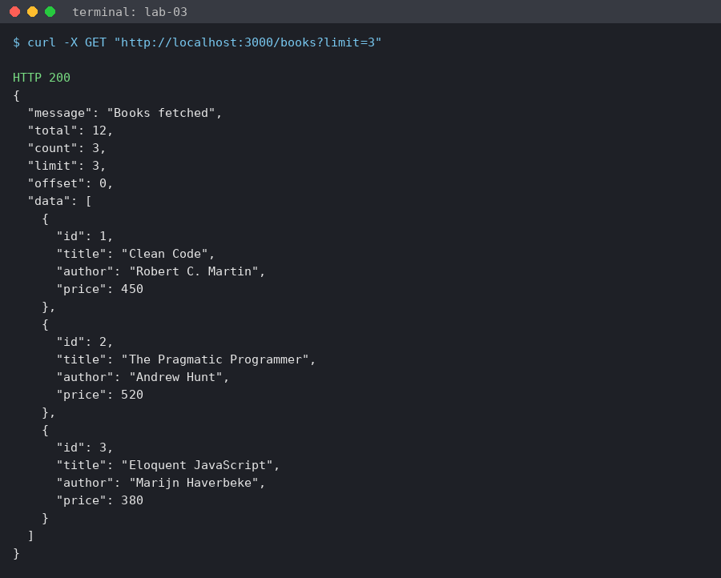

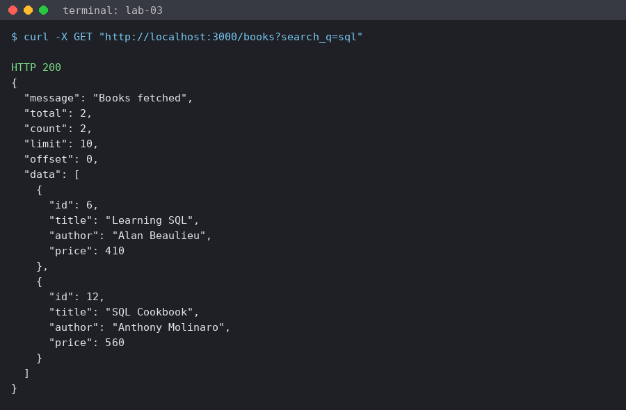

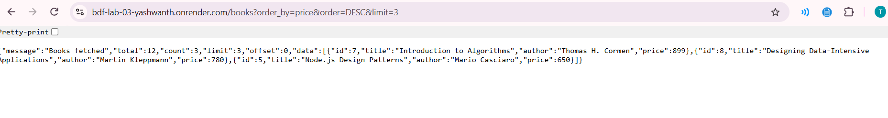

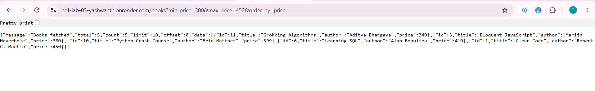

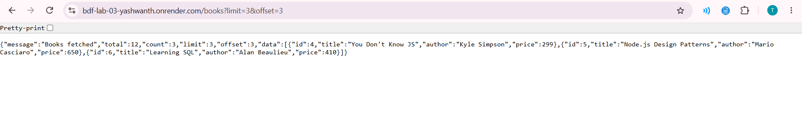

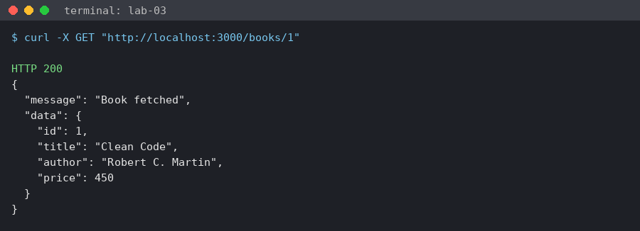

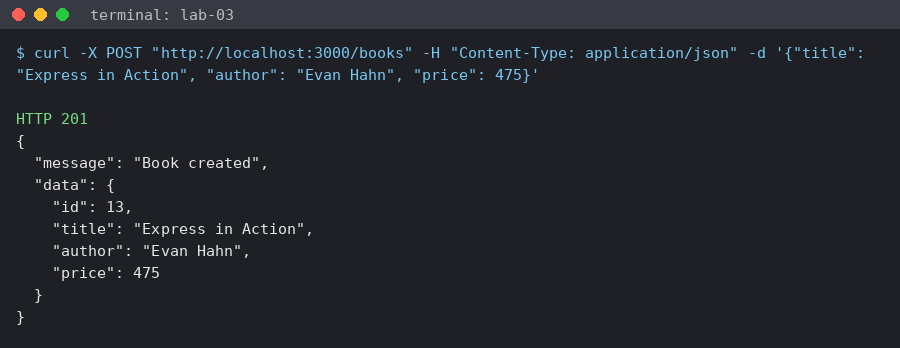

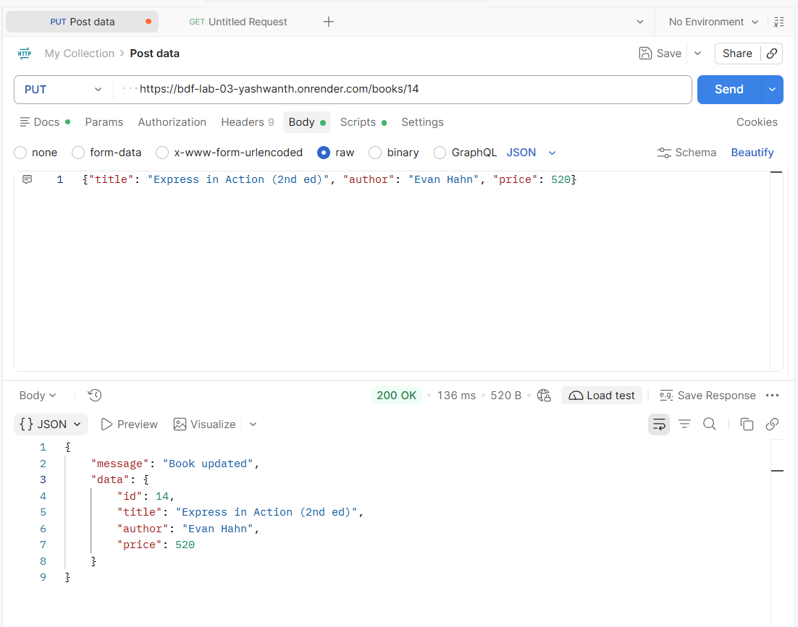

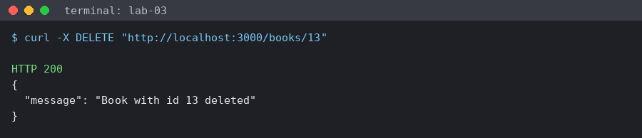

### Error cases

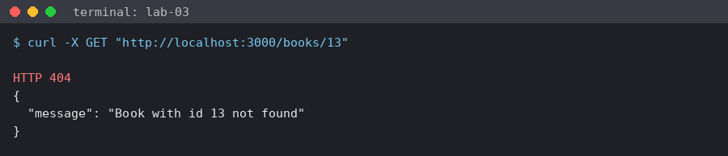

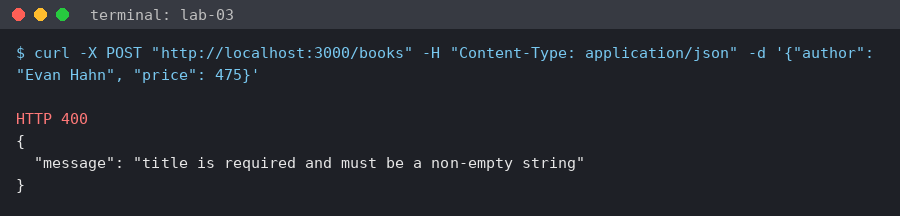

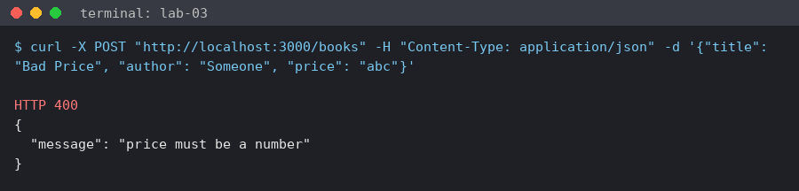

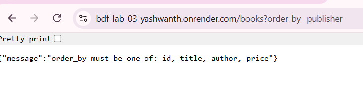

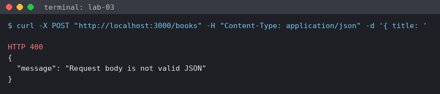

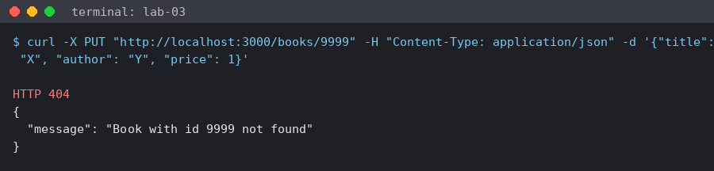

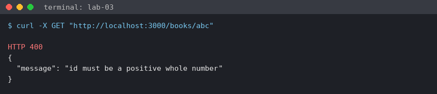

### Database view and tests

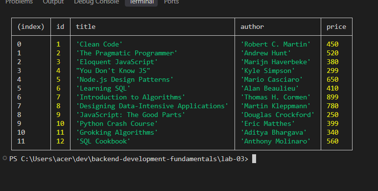

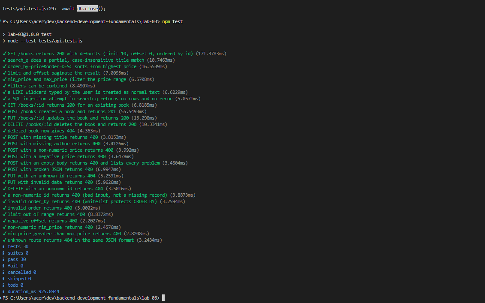

### Debugging exercise

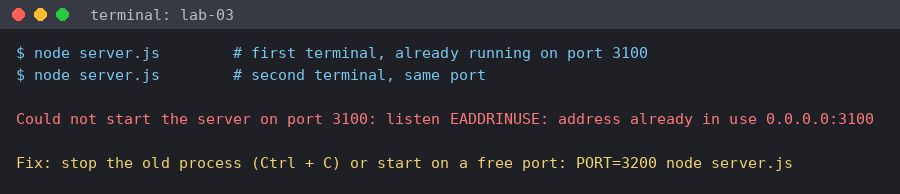

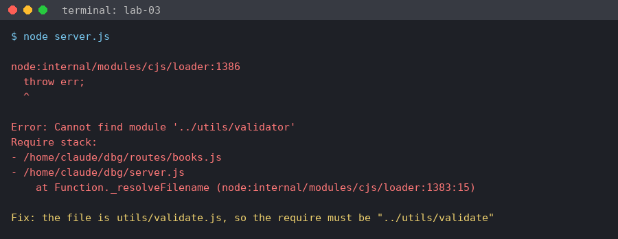

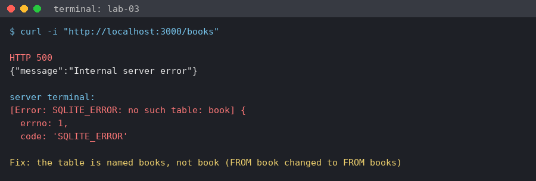

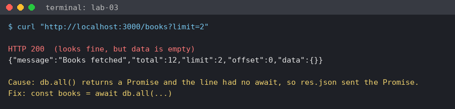

---

## Deployment

The API can be deployed on Render as a Web Service.

| Setting | Value |
| --- | --- |
| Repository | the course repository, branch `main` |
| Root Directory | `lab-03` |
| Build Command | `npm install` |
| Start Command | `npm start` |
| Instance type | Free |
| Environment variables | `NODE_VERSION` = `22` (see the note below), `PORT` is set by Render |

**Database package version:** the newest `sqlite3` (6.x) ships a prebuilt binary that needs glibc 2.38, and Render's servers have an older glibc, so the first deploys crashed with `GLIBC_2.38 not found` (`ERR_DLOPEN_FAILED`). This project uses `sqlite3` 5.1.7, whose prebuilt binary only needs very old glibc versions, and it works on Render. Node is also pinned to 22 with the `NODE_VERSION` variable, and `package.json` has `"node": ">=20 <23"` so the range is bounded.

The free plan sleeps when idle, so the first request after a break can take around 50 seconds. SQLite stores data in a file and the free plan's disk is not permanent, so the database is recreated with the 12 sample books when the service restarts or redeploys. This is fine for a lab, and a real project would use a hosted database.

---

## Security checklist

- [x] `.env` is in `.gitignore` and was never committed, only `.env.example` is
- [x] `node_modules` is not committed
- [x] All SQL uses parameterised queries, user input is never joined into the SQL text
- [x] `order_by` and `order` are checked against a whitelist
- [x] Every route returns the correct status code
- [x] Internal error details are logged on the server and never sent to the client
- [x] No passwords or secrets are stored or logged in this lab

---

## Notes: problems faced and how I solved them

| Problem | Solution |
| --- | --- |
| `ORDER BY` column cannot be passed as a `?` placeholder | Checked `order_by` and `order` against a whitelist, anything else returns 400 |
| `%` typed in the search box matched every book | Escaped `%`, `_` and `\` and used `LIKE ? ESCAPE '\'` |
| With Express 5 a port conflict printed "running" but the server never started | Checked the `err` argument in the `app.listen` callback and exited with a message |
| A bad id like `abc` and a missing id like `9999` both looked like "not found" | Used 400 for an invalid id and 404 for a valid id that does not exist |
| Invalid JSON in the body gave a long default Express error | Added an error handler that returns `{ "message": "Request body is not valid JSON" }` with 400 |
| The first Render deploys crashed with `ERR_DLOPEN_FAILED` and `GLIBC_2.38 not found` for `sqlite3` | Render has an older glibc than the `sqlite3` 6.x binary needs. I changed to `sqlite3` 5.1.7 and pinned Node 22 (`NODE_VERSION=22`, `engines` set to `>=20 <23`) |
| The total count changed meaning when filters were used | Ran the `COUNT(*)` query with the same `WHERE` filters as the list query |
